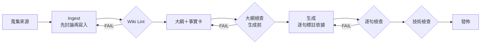

# Edge AI LLM Wiki

北科電子 112360106 黃資宸 · 第十週作業：用 LLM Wiki 做一份教學 HTML 簡報

- 網頁版（GitHub Pages）：https://unknownadminpupupu.github.io/edge-ai-llm-wiki/
  - 教學簡報：[`docs/slides.html`](https://unknownadminpupupu.github.io/edge-ai-llm-wiki/slides.html)
  - Wiki 瀏覽：[`docs/wiki.html`](https://unknownadminpupupu.github.io/edge-ai-llm-wiki/wiki.html)

## 主題

Edge AI（邊緣 AI）：讓 AI 模型在手機、感測器、微控制器這些靠近資料的裝置上執行。

## 結構（Karpathy 的 LLM Wiki 模式）

| 資料夾 | 內容 |
|---|---|
| [`CLAUDE.md`](CLAUDE.md) | Schema：頁面格式、來源標記規則、衝突與舊資料的處理 |
| [`raw/`](raw/) | 6 篇原始來源的摘錄筆記（S1～S6），建立後不修改 |
| [`wiki/`](wiki/) | 15 個概念頁＋[`index.md`](wiki/index.md)＋[`log.md`](wiki/log.md)（執行紀錄） |
| [`discussion/`](discussion/) | 「先討論、後生成」的紀錄，以及 loop／graph 設計 v1 → v2 |
| [`slides/`](slides/) | 教學大綱、事實卡（factcards.json）、Run 1 與 Run 2 的簡報原始檔 |
| [`checks/`](checks/) | 每次檢查的報告（Wiki Lint、大綱檢查、簡報逐句檢查、人工複查） |
| [`tools/`](tools/) | 檢查與建置腳本 |
| [`docs/`](docs/) | GitHub Pages 發佈的網頁 |

## 流程（v2）



完整說明見 [`discussion/F-workflow-v1-v2.md`](discussion/F-workflow-v1-v2.md)。

## 重跑檢查

```bash
pip install markdown beautifulsoup4 playwright
python3 tools/lint_wiki.py . checks/lint.md
python3 tools/check_outline.py . slides/factcards.json checks/outline.md
python3 tools/check_slides_v2.py . slides/factcards.json docs/slides.html checks/slides.md
```
