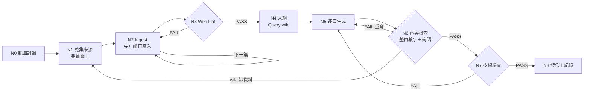
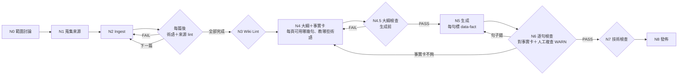

# Loop／Graph 設計：Workflow v1 → v2

## Workflow v1（第一次實際執行 Run 1 用的流程）

文字版：取得資料（N1）→ 逐篇 ingest（N2，loop）→ wiki 健檢（N3，不過就回 N2）→ 查 wiki 排大綱（N4）→ 逐頁生成（N5，loop）→ 內容檢查（N6，不過回 N5；wiki 缺資料回 N1/N2）→ 技術檢查（N7）→ 發佈（N8）

## Run 1 發現的問題

| 節點 | 發現錯誤 | 錯誤真正產生的地方 |
|---|---|---|
| N3 Wiki Lint | 21 個（術語沒定義 18） | N2 寫 wiki 時 |
| N6 內容檢查 | 8 個＋人工 1 個（術語先用後教 4、數字不在指定頁 3、太擠 1） | N5 生成時 |
| N3／N7 技術 | 1 個（手機橫向捲動） | 產 HTML 時 |

問題都在「生成之後」才被抓到。大綱只寫「這頁看哪個 wiki 頁」，沒規定「能用哪幾句」「哪頁負責教哪個術語」，所以生成時會用到大綱外的內容、自己換算數字、術語還沒教就先用。

## Workflow v2（Run 2 用的流程）

改了三件事：
1. **新增 N4.5 大綱檢查**：把「術語先用後教」「事實找不到」的檢查，從生成後（N6）往前移到生成前。
2. **N5 生成必須標註**：每個論點都要寫出依據的事實卡 id，沒有依據的句子只能是不含數字的引導句（frame）。
3. **N6 改成逐句檢查**：數字只能對它引用的那幾句比，不再對整頁比（避免巧合配對）；字面重疊太低的句子列成 WARN，由人工確認意思。
4. （設計上）術語 lint 從「全部 ingest 完」往前移到「每篇 ingest 後」。Run 2 沒有新增來源，這條還沒實際跑到。

## Run 1 vs Run 2

| | Run 1（v1） | Run 2（v2） |
|---|---|---|
| 生成前抓到的問題 | 0 | 7（N4.5） |
| 生成後抓到的問題 | 8＋人工 1 | 4 FAIL＋5 個語意錯誤（從 17 條 WARN 複查出來） |
| v1 抓不到、v2 抓到的 | — | 5 個沒有數字的錯：多寫「位置」、過度概括、wiki 外的細節、無來源的例子、引用錯頁 |
| 最後結果 | PASS | PASS（9 條 WARN 經人工確認） |

## 哪些步驟會重複（loop）
- N2：每篇來源跑一次，共 6 次
- N5→N6：每頁生成後檢查，不過就重寫這一頁（最多 2 次）
- N3、N4.5、N6、N7：任何一個 FAIL 都回到上一個生成節點重做，再重跑檢查

## 為什麼這樣設計
- 錯誤越晚發現越貴：大綱階段改一行 JSON，比生成後改整頁 HTML 便宜。
- 「可追溯」是教學簡報的底線：每句話都要能從簡報 → wiki → 原始來源一路查回去。
- 檢查工具本身也會錯（Run 1 的數字比對有子字串 bug），所以每個檢查都要做反向測試，並保留人工複查。
